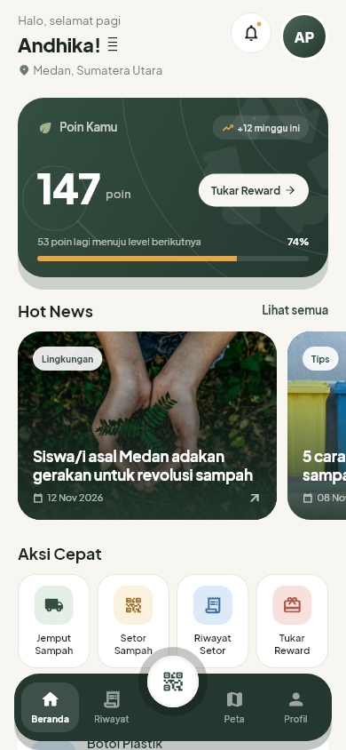
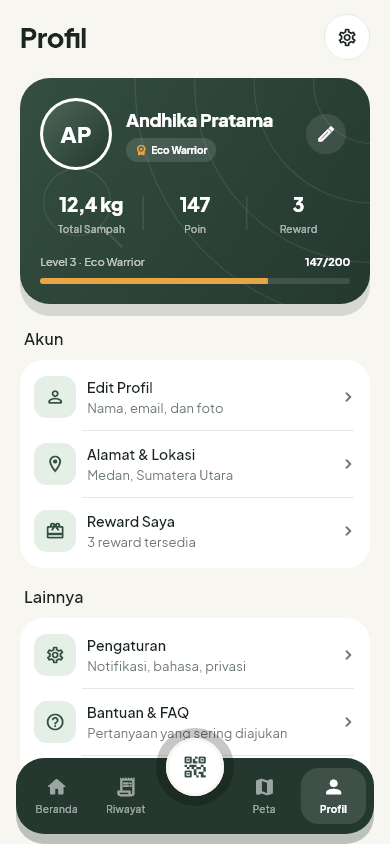
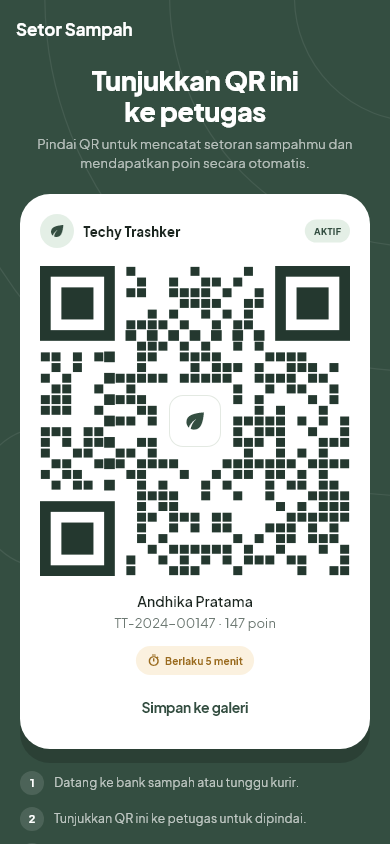

# Techy Trashker

Aplikasi pengelolaan sampah dan bank sampah — prototype Flutter berdasarkan desain
Figma **Techy Trashker (FORDIGI)**.

> Status: **UI prototype** dengan data dummy. Belum ada backend, autentikasi
> nyata, atau penyimpanan permanen.

## Screenshots

| Home | Riwayat | Peta |
| --- | --- | --- |
|  |  |  |

| Onboarding | Login | Profil | QR Setor |
| --- | --- | --- | --- |
|  |  |  |  |

## Fitur prototype

- **Onboarding** 3 halaman dengan badges, dots indicator, dan skip.
- **Login / Daftar** dengan validasi form dan akun demo.
- **Home** — sapaan, poin, Hot News, aksi cepat, aktivitas terakhir, bank terdekat.
- **Riwayat** — ringkasan poin/berat, filter Setor/Jemput, sorting, detail transaksi.
- **Peta** — peta radar stylized, pencarian bank sampah, marker interaktif, filter.
- **Profil** — statistik, level progress, menu akun, pengaturan, bantuan, logout.
- **QR Setor** — kartu member, QR-style pattern, instruksi, simpan/bagikan.
- **Bottom sheet interaktif** untuk notifikasi, jadwal penjemputan, reward, berita,
  dan detail transaksi.

## Tech stack

- Flutter 3.44+ / Dart 3.12+
- `go_router` untuk routing dan stateful bottom navigation
- Material 3 + custom theme
- Plus Jakarta Sans (bundled di `assets/fonts/`)
- Data dummy lokal di `lib/data/mock_data.dart`

## Menjalankan

```bash
flutter pub get
flutter run
```

Untuk web:

```bash
flutter run -d chrome
```

Build production:

```bash
flutter build web
flutter build apk --release
```

## Struktur project

```text
lib/
├── main.dart
├── app.dart
├── core/
│   ├── router.dart
│   ├── theme/            # warna, typography, theme
│   ├── utils/            # formatter, material icon mapping
│   └── widgets/          # AppCard, AppSheet, bottom nav, EcoPattern, dll
├── data/
│   ├── models/           # UserProfile, NewsItem, WasteDeposit, WasteBank
│   ├── mock_data.dart
└── features/
    ├── onboarding/
    ├── auth/
    ├── shell/
    ├── home/
    ├── history/
    ├── map/
    ├── profile/
    └── qr/
```

## Testing

```bash
flutter analyze
flutter test
```

Golden screenshots ada di `test/goldens/` dan `docs/screenshots/`. Untuk
memperbarui screenshot setelah perubahan UI:

```bash
flutter test --update-goldens test/screens_golden_test.dart
```

## Sumber desain

- Figma: [Techy Trashker (FORDIGI)](https://www.figma.com/design/vor2SRshrmWkFdKPTelwut/Techy-Trashker--FORDIGI-?node-id=0-1)
- Analisis desain lengkap: [`docs/design-analysis.md`](docs/design-analysis.md)

## Catatan

- Foto berita memakai placeholder Unsplash untuk kebutuhan prototype. Ganti dengan
  aset final dari Figma saat tersedia.
- Warna diambil dari board Figma (`#344E41` sebagai brand utama). Typography dan
  spacing adalah aproksimasi karena akses Figma saat ini view-only.
- Akun demo: `andhika@techytrashker.id` / `rahasia123` (hanya UI, tidak divalidasi
  ke backend).

## Roadmap berikutnya

- [ ] Ganti mock data dengan API backend.
- [ ] Autentikasi dan penyimpanan token.
- [ ] Integrasi peta nyata (Google Maps / Mapbox) dan geolokasi.
- [ ] Form penjemputan dengan tanggal, alamat, dan upload foto.
- [ ] QR asli + short-lived token.
- [ ] Reward redemption dan riwayat penukaran.
- [ ] Notifikasi push.
- [ ] Export aset final dari Figma dan fine-tune 1:1.
