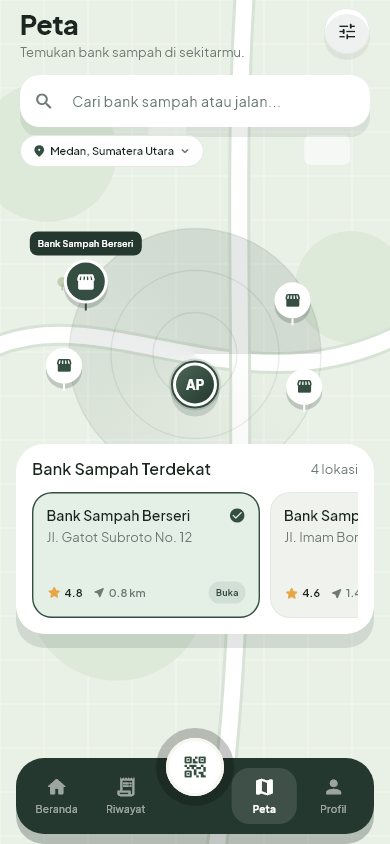

# Techy Trashker

Aplikasi pengelolaan sampah dan bank sampah — prototype Flutter berdasarkan desain
Figma **Techy Trashker (FORDIGI)**.

> Status: **MVP** — UI prototype Flutter + backend API di [`backend/`](backend/).
> Backend sudah mencakup auth, profil/poin, setoran, penjemputan, QR, reward,
> leaderboard, dan admin. Aplikasi Flutter masih memakai data dummy; integrasi
> API adalah langkah berikutnya.

## Screenshots

| Home | Riwayat | Peta |
| --- | --- | --- |
|  |  |  |

| Onboarding | Login | Profil | QR Setor |
| --- | --- | --- | --- |
|  |  |  |  |

## Fitur prototype

- **Onboarding** 3 halaman dengan badges, dots indicator, dan skip.
- **Login / Daftar** dengan validasi form dan akun demo.
- **Home** — sapaan, poin, Hot News, aksi cepat, aktivitas terakhir, bank terdekat.
- **Riwayat** — ringkasan poin/berat, filter Setor/Jemput, sorting, detail transaksi.
- **Peta** — peta radar stylized, pencarian bank sampah, marker interaktif, filter.
- **Profil** — statistik, level progress, menu akun, pengaturan, bantuan, logout.
- **QR Setor** — kartu member, QR-style pattern, instruksi, simpan/bagikan.
- **Bottom sheet interaktif** untuk notifikasi, jadwal penjemputan, reward, berita,
  dan detail transaksi.

## Tech stack

- Flutter 3.44+ / Dart 3.12+
- `go_router` untuk routing dan stateful bottom navigation
- Material 3 + custom theme
- Plus Jakarta Sans (bundled di `assets/fonts/`)
- Data dummy lokal di `lib/data/mock_data.dart`
- Backend: Fastify 5 + TypeScript, Supabase Auth, Supabase Postgres, Drizzle ORM

## Backend API (MVP)

Backend ada di [`backend/`](backend/) dan sudah siap dipakai sebagai API MVP:

- **Auth** — registrasi, login, refresh token, logout (Supabase Auth).
- **Profil & poin** — level, progress, total berat, ledger poin.
- **Berita & bank sampah** — list/detail, pencarian, jarak terdekat.
- **Setoran** — drop-off, jadwal penjemputan, pembatalan, penyelesaian oleh
  petugas dengan poin otomatis.
- **QR setor** — token 5 menit, sekali pakai, scan oleh petugas.
- **Reward** — katalog, penukaran poin, stok, refund saat dibatalkan admin.
- **Admin** — CRUD reward, fulfillment redemption.
- **Leaderboard** dan dokumentasi OpenAPI di `/docs`.

Quick start (detail lengkap ada di [`backend/README.md`](backend/README.md)):

```bash
cd backend
cp .env.example .env      # isi kredensial Supabase
npm install
npm run db:migrate
npm run db:seed
npm run dev               # http://localhost:3000/docs
```

Akun demo backend:

| Role | Email | Password |
| --- | --- | --- |
| Member | `andhika@techytrashker.id` | `rahasia123` |
| Petugas | `petugas@techytrashker.id` | `rahasia123` |
| Admin | `admin@techytrashker.id` | `rahasia123` |

## Menjalankan

```bash
flutter pub get
flutter run
```

Untuk web:

```bash
flutter run -d chrome
```

Build production:

```bash
flutter build web
flutter build apk --release
```

## Struktur project

```text
lib/
├── main.dart
├── app.dart
├── core/
│   ├── router.dart
│   ├── theme/            # warna, typography, theme
│   ├── utils/            # formatter, material icon mapping
│   └── widgets/          # AppCard, AppSheet, bottom nav, EcoPattern, dll
├── data/
│   ├── models/           # UserProfile, NewsItem, WasteDeposit, WasteBank
│   ├── mock_data.dart
└── features/
    ├── onboarding/
    ├── auth/
    ├── shell/
    ├── home/
    ├── history/
    ├── map/
    ├── profile/
    └── qr/

backend/
├── src/                  # Fastify routes, Supabase auth, Drizzle schema
├── drizzle/              # migration SQL
├── tests/                # integration tests (PGlite + fake auth)
└── README.md             # setup Supabase, endpoint, deploy
```

## Testing

Frontend:

```bash
flutter analyze
flutter test
```

Golden screenshots ada di `test/goldens/` dan `docs/screenshots/`. Untuk
memperbarui screenshot setelah perubahan UI:

```bash
flutter test --update-goldens test/screens_golden_test.dart
```

Backend:

```bash
cd backend
npm test        # PGlite + fake auth, tanpa kredensial Supabase
npm run typecheck
```

## Sumber desain

- Figma: [Techy Trashker (FORDIGI)](https://www.figma.com/design/vor2SRshrmWkFdKPTelwut/Techy-Trashker--FORDIGI-?node-id=0-1)
- Analisis desain lengkap: [`docs/design-analysis.md`](docs/design-analysis.md)

## Catatan

- Foto berita memakai placeholder Unsplash untuk kebutuhan prototype. Ganti dengan
  aset final dari Figma saat tersedia.
- Warna diambil dari board Figma (`#344E41` sebagai brand utama). Typography dan
  spacing adalah aproksimasi karena akses Figma saat ini view-only.
- Akun demo UI: `andhika@techytrashker.id` / `rahasia123` (UI prototype tidak
  memvalidasi ke backend). Akun demo backend sudah disiapkan di
  [`backend/README.md`](backend/README.md) dan dibuat oleh `npm run db:seed`.

## Roadmap berikutnya

- [x] Backend API MVP (Fastify + Supabase Auth/Postgres + Drizzle).
- [x] Autentikasi, profil, poin, setoran, QR, reward, leaderboard, admin.
- [ ] Sambungkan aplikasi Flutter ke API (ganti `mock_data.dart`).
- [ ] Simpan token aman + auto-refresh di Flutter.
- [ ] Integrasi peta nyata (Google Maps / Mapbox) dan geolokasi.
- [ ] Form penjemputan dengan tanggal, alamat, dan upload foto.
- [ ] QR asli di Flutter (render `qrPayload` + countdown token).
- [ ] Halaman reward redemption dan riwayat penukaran di Flutter.
- [ ] Notifikasi push.
- [ ] Export aset final dari Figma dan fine-tune 1:1.
